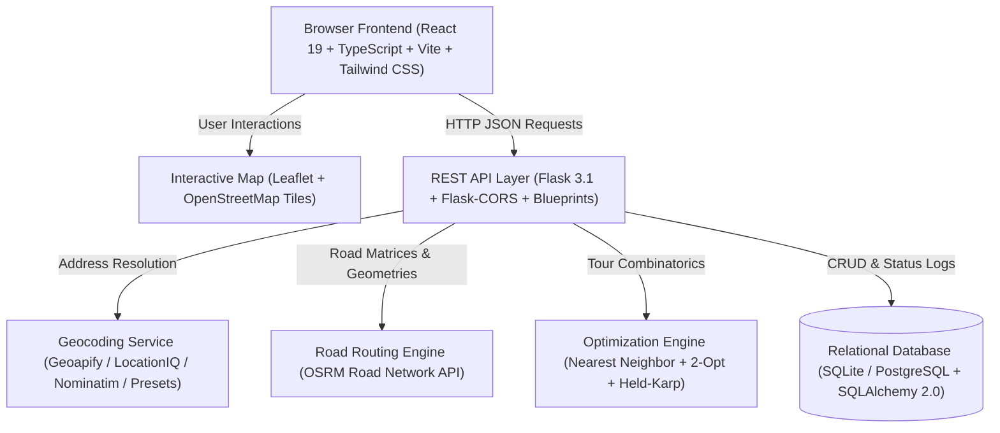
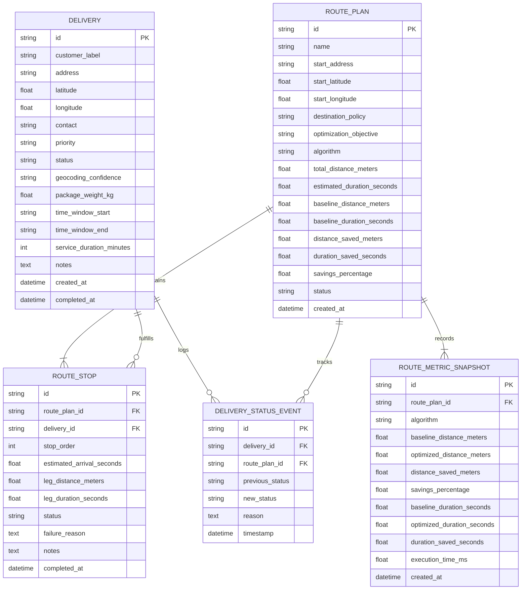
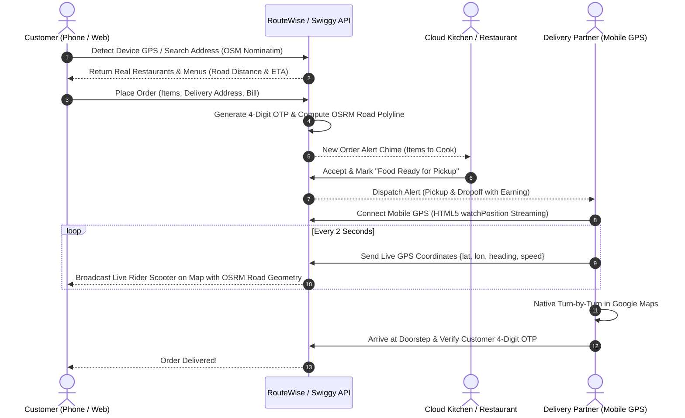

# RouteWise AI — Intelligent Delivery Route Planning & Optimization System

An enterprise-structured, college PBL (Project-Based Learning) web application designed for last-mile delivery operations, geospatial road network routing, and combinatorial route optimization.

Built with **React, TypeScript, Vite, Tailwind CSS, Leaflet, Flask, SQLAlchemy, OSRM, and 2-Opt Local Search Heuristics**.

---

## 📌 Executive Summary

Last-mile delivery represents upwards of **53% of total logistics costs**. Standard naive approaches either deliver in the sequential order orders are received or compute straight-line (Euclidean) distances that completely ignore physical urban barriers, bridges, one-way roads, and traffic restrictions.

**RouteWise AI** solves this problem by:
1. Geocoding actual street addresses across Indian urban metros (with Navi Mumbai as the benchmark demonstration region).
2. Querying road-based travel distance and duration matrices from **OSRM (Open Source Routing Machine)**.
3. Solving the NP-hard multi-stop Traveling Salesperson Problem (TSP) using **Nearest Neighbor initial heuristics and 2-Opt local search refinement**.
4. Guaranteeing that the optimized route is mathematically never worse than the baseline sequential route.
5. Providing driver dispatch cockpits, external Google Maps turn-by-turn navigation links, and full database persistence in SQLite/PostgreSQL.

---

## 🏛️ System Architecture



---

## 🗄️ Database Entity-Relationship (ER) Diagram



---

## ⚡ Optimization Pipeline Flowchart

```mermaid
flowchart TD
    Start([Input Depot & Delivery Stops]) --> Val{Validate Coordinates & Policy}
    Val -->|Invalid| Err[Return Validation Error]
    Val -->|Valid| Mat[Request OSRM Distance & Duration Matrix]
    Mat --> Base[Calculate Baseline Sequential Cost]
    Base --> NN[Construct Initial Tour with Nearest Neighbor O(N²)]
    NN --> TwoOpt[Execute 2-Opt Local Search Swaps]
    TwoOpt --> Prio{Enforce Priorities?}
    Prio -->|Yes| PrioSwap[Re-rank Urgent/High Deliveries & Refine]
    Prio -->|No| CheckCost
    PrioSwap --> CheckCost{Optimized Cost < Baseline?}
    CheckCost -->|Yes| Accept[Accept 2-Opt Tour Sequence]
    CheckCost -->|No| Retain[Retain Baseline Sequence Safeguard]
    Accept --> RoadGeom[Fetch Detailed Road Polyline from OSRM]
    Retain --> RoadGeom
    RoadGeom --> Calc[Compute Distance Saved & % Improvement]
    Calc --> Persist[(Save Plan & Snapshots to SQLite)]
    Persist --> Return([Return Manifest, Geometry & Metrics to Client])
```

---

## 🚀 Quick Start Guide (Windows)

### Prerequisites
- **Python 3.10+** (Python 3.13 supported)
- **Node.js 18+** & **npm**

### Step 1: Start the Backend (Flask API)
```powershell
cd "backend"
# Create & activate a virtual environment (optional)
python -m venv venv
venv\Scripts\activate

# Install dependencies
pip install -r requirements.txt

# Run server
python run.py
```
Backend will be live at `http://127.0.0.1:5000/api/v1`.

### Step 2: Start the Frontend (Vite Dev Server)
In a new terminal window:
```powershell
cd "frontend"
# Install dependencies
npm install

# Start development server
npm run dev
```
Frontend will be live at `http://localhost:5173/`.

### Step 3: Run the Automated Test Suite
```powershell
# In backend directory
pytest tests -v
```
All 26 backend tests will run and validate algorithm correctness, closed/open routes, asymmetric matrices, Swiggy/Zomato food orders, real device GPS streaming, and API persistence.

---

## 🍕 Swiggy & Zomato Real-Time Delivery Ecosystem

A production-grade, three-sided delivery marketplace model built with real Indian metro data and live device telemetry:



### 📱 Connecting Real Physical Smartphones
1. **Network Pairing**: The backend automatically detects the machine's local Wi-Fi IP (e.g., `192.168.0.101`).
2. **Scan QR Code**: Tap **"Connect Phone"** anywhere in the application to display a scannable QR code.
3. **Open on Phone**: Scan the QR code using an iPhone or Android camera to open `http://<LAN_IP>:5173/driver`.
4. **Live GPS Streaming**: Tap **"📡 Share Real Phone GPS"** to broadcast your phone's native GPS hardware coordinates (`navigator.geolocation.watchPosition`) directly to the customer's live tracking map!

---

## 📡 API Reference (`/api/v1`)


| Method | Endpoint | Description |
|---|---|---|
| `GET` | `/health` | System health check and database status |
| `GET` | `/dashboard` | Authoritative operational KPIs computed from DB |
| `GET` | `/deliveries` | List delivery orders with status/priority filtering |
| `POST` | `/deliveries` | Create a new delivery order |
| `PATCH` | `/deliveries/:id` | Update delivery order details |
| `DELETE` | `/deliveries/:id` | Permanently delete delivery order |
| `POST` | `/deliveries/seed-demo` | Populate authentic Navi Mumbai demonstration records |
| `POST` | `/deliveries/clear-demo` | Clear seeded demonstration records |
| `POST` | `/geocoding/search` | Search address via configured provider (Geoapify/Nominatim) |
| `POST` | `/geocoding/reverse` | Reverse geocode coordinates to street address |
| `POST` | `/routes/preview` | Preview baseline road distance/duration before optimization |
| `POST` | `/routes/optimize` | Run 2-Opt optimization and persist plan |
| `GET` | `/routes` | List saved route plans |
| `GET` | `/routes/:id` | Get single route plan details and stops |
| `DELETE` | `/routes/:id` | Delete route plan |
| `POST` | `/routes/:id/duplicate` | Duplicate route plan |
| `POST` | `/routes/:id/start` | Dispatch route into `in_transit` status |
| `POST` | `/routes/:id/stops/:stopId/status` | Mark stop as `delivered` or `failed` with failure reason |
| `GET` | `/routes/:id/export` | Download CSV delivery manifest |
| `GET` | `/analytics` | Aggregated chart-ready performance statistics |
| `GET` | `/algorithms/compare` | Benchmark Dijkstra, A*, Nearest Neighbor, and 2-Opt |

---

## 🎓 PBL Viva Examination Guide

### 1. What is the difference between Pathfinding and Multi-Stop Route Optimization?
- **Pathfinding** (e.g., Dijkstra, A*): Finds the shortest physical road path between **two specific points** (Source $A \to$ Destination $B$) through intersections and road links.
- **Route Optimization / TSP** (e.g., Nearest Neighbor, 2-Opt): Determines the **optimal ordering of $N$ stops** (visit sequence) so that the entire tour is minimal. Pathfinding provides the distance matrix that the TSP optimizer consumes.

### 2. Why is straight-line Euclidean distance inaccurate for urban delivery planning?
Real urban road networks are constrained by rivers (e.g., Thane Creek), railway tracks, bridges, flyovers, traffic medians, and one-way streets. Two locations separated by 1 km straight-line distance may require a 4.5 km driving detour. Evaluating TSP using Euclidean distances produces invalid stop orderings.

### 3. How does the 2-Opt heuristic avoid getting stuck in poor initial solutions?
The greedy Nearest Neighbor heuristic is fast ($O(N^2)$), but often causes criss-crossing routes and leaves distant stops visited at the very end. The 2-Opt algorithm systematically considers cutting two edges and reconnecting them in reversed order. If the new combination reduces the road tour cost, it is adopted. This eliminates intersecting routes and achieves polynomial-time local optimality.

### 4. Does real road routing automatically mean live traffic?
No. Standard road routing calculates geometry and duration from static speed limits tagged in OpenStreetMap. Dynamic live traffic requires paid, telemetry-backed feeds (e.g., Google Maps Platform, TomTom Live). RouteWise AI uses reproducible road-network matrices for deterministic college evaluation.

---

## 🛡️ License
Academic demonstration software developed for College PBL Route Planning & Optimization presentation. OpenStreetMap tile attribution included.
